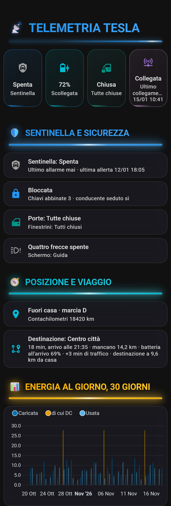

# Fleet Telemetry for Tesla vehicles in Home Assistant (unofficial)

Self-hosted [Tesla Fleet Telemetry](https://github.com/teslamotors/fleet-telemetry) for Home Assistant: Tesla's official
server in an add-on, about 85 MQTT entities, a ready-made dashboard and the vehicle's on-screen alerts translated into
Italian.

> **Status: draft.** Work in progress, tested on one Model 3 (firmware 2026.38.6) with Home Assistant OS 2026.11 on
> amd64. Entity names, dashboard texts and alert translations are in Italian for now.
>
> Not affiliated with, endorsed by or connected to Tesla, Inc. "Tesla" is a trademark of Tesla, Inc. and is used here
> only to describe compatibility.

*Screenshots made with demo data.*

## What you get

- **Add-on** with Tesla's official `fleet-telemetry` server (v0.10.0, image pinned by digest). The car connects to it
  with mutual TLS and the server publishes every record on MQTT.
- **Sensors** (MQTT package generated for your VIN): Sentry Mode with last alarm and last alert, doors, windows, lock,
  hazard lights, gear, driver seat, location, navigation (minutes, km and battery % at arrival, traffic delay),
  charging (state, power, current, phases, port, latch, schedule), battery (level, energy, BMS capacity, module
  temperatures, heater), climate and seats, tyre pressures and warnings, lifetime counters, software version.
- **Dashboard** with 24-hour, 7-day, 30-day and 1-year charts.
- **Translated alerts** (optional AppDaemon app): the alerts the car shows on screen, translated into Italian
  (1,456 Model 3 codes), a 12 V battery diagnosis sensor and optional Telegram messages.
- **Tools** to create the certificates and to send the configuration to the car.

Why: the car pushes a field only when it changes, about one second later, without being woken up. Tesla prices
streaming at 150,000 signals per US dollar, against 500 vehicle data requests per dollar.

## Requirements

**1. A working Fleet API setup.** The usual way is the
[Tesla HTTP Proxy add-on by llamafilm](https://github.com/llamafilm/tesla-http-proxy-addon) with the
[Tesla custom integration](https://github.com/alandtse/tesla). It gives you:

- a developer application on [developer.tesla.com](https://developer.tesla.com) with billing enabled;
- a domain with a valid HTTPS certificate on port 443 that publishes the public key
  (`/.well-known/appspecific/com.tesla.3p.public-key.pem`), usually through the Nginx SSL proxy add-on;
- the virtual key paired with the car;
- a token for the Fleet API.

**2. For the telemetry:**

- a TCP port (default 4443) forwarded by the router **directly** to the Home Assistant host. **Do not put it behind a
  reverse proxy** (Nginx, Nginx Proxy Manager, Cloudflare): the car authenticates with its own client certificate, and
  a proxy that terminates TLS breaks it;
- a DNS name for your public IP (a DuckDNS name works);
- the server certificate does **not** need to be public: `crea_certificati.py` creates your own CA, and the CA is sent
  to the car inside the configuration;
- the Mosquitto add-on;
- a recent Home Assistant (tested on 2026.10 and 2026.11: the package uses `default_entity_id` and the plural
  `triggers`/`actions` syntax);
- recent car firmware: navigation fields need 2024.26 or later; the lifetime charge counters need 2026.32 or later
  (older firmware rejects those fields and the two sensors stay unknown);
- an amd64 Home Assistant host (other architectures are not built yet).

**3. Signing.** Tesla only accepts a telemetry configuration signed with the application key. The llamafilm add-on
(2.3.0) bundles a 2024 version of Tesla's vehicle-command that does **not** sign it. `tools/firma_una_volta.py` checks
everything first, then takes the key from a backup of that add-on, starts Tesla's current proxy in a temporary add-on for
a few minutes, sends the configuration and deletes everything (it verifies the cleanup with the Supervisor). If your
proxy already signs, `configura_auto.py invia` is enough.

> **Backups:** for a few minutes the application key (which is also a virtual key of your car) is inside a temporary
> partial backup without password. If something copies every backup to the cloud (for example a backup sync add-on),
> pause it while the script runs. The script stops if an automatic Home Assistant backup is due within 30 minutes.

## Tools on the PC

Python 3.11 or later: `pip install cryptography websocket-client PyYAML`. Copy `tools/esempio_config.json` to
`tools/config.json` (excluded from git) and fill it in:

| Key | Meaning |
|---|---|
| `ha_url` | **LAN address** of the Home Assistant host (also used to reach the temporary signing proxy) |
| `ha_token_file` | file with a long-lived access token of an **administrator** (Supervisor API, backups, MQTT, helpers) |
| `telemetry_hostname`, `telemetry_port` | DNS name and port the car connects to (they go into the server certificate) |
| `topic_base` | MQTT topic base of the add-on (`telemetria_tesla`, fixed in the add-on) |
| `config_days` | validity of the car configuration, in days |
| `private_dir` | where the CA and server keys are kept (never in the repository) |
| `vin` or `vin_entity` | the VIN, or an entity with a `vin` attribute (for example the `_online` sensor of the Tesla custom integration) |
| `firmware_entity` | optional: an `update` entity with the installed car firmware (only for a warning) |
| `expiry_helper` | `input_datetime` where the expiry date is written; created automatically with the default name, empty to skip |
| `token_source` | `tesla_custom` (read the integration token from `core.config_entries`, in memory only, never refreshed) or `file` |
| `core_config_entries`, `token_file` | path of `.storage/core.config_entries` (Samba share `config`) or of a file with a Fleet API access token (keep it outside the repository) |
| `proxy_url`, `proxy_cert` | signing proxy and its certificate (llamafilm: port 4430, `share/tesla/selfsigned.pem`) |
| `proxy_addon_slug`, `public_key_url` | slug of the llamafilm add-on and URL of your published public key |
| `ssh_host`, `ssh_key` | SSH add-on with key authentication; connect once by hand to accept the host key (the scripts use BatchMode) |
| `ssh_exe`, `gpg_exe`, `gpgconf_exe` | on Windows the programs of Git for Windows are used automatically; with Gpg4win set the two gpg paths |
| `share_addons`, `share_addon_configs`, `share_backup` | Samba shares of Home Assistant. Windows: `//host/share` after logging in to the shares once; Linux and macOS: mount them and use the mount paths |
| `temp_proxy_port` | local port of the temporary signing proxy (not forwarded by the router) |
| `charging_check_entities` | entities that must be `off` before signing (for example the charging switch) |

The scripts mask the VIN, the telemetry host name and any location in what they print. Check the output anyway before
pasting it into a public issue.

## Installation

1. **Certificates:** `python tools/crea_certificati.py crea`. Keys stay in `private_dir`.
2. **Add-on:** add this repository in the add-on store (Settings, Add-ons, Add-on store, Repositories) and install
   "Telemetria Tesla (non ufficiale)", or copy the `telemetria_tesla` folder into the `addons` share and install it as a
   local add-on. Start it once: it stops because the certificates are missing, and the Supervisor creates its folder in
   `addon_configs` (`<hash>_telemetria_tesla` from the repository, `local_telemetria_tesla` as local add-on). Copy
   `server.crt` and `server.key` there, start it again and turn on the watchdog.
3. **Router:** forward TCP 4443 to the Home Assistant host, port 4443.
4. **Car:** `python tools/configura_auto.py anteprima` shows what will be sent and `configura_auto.py verifica` checks
   VIN, token and CA. Then `python tools/firma_una_volta.py` (llamafilm users) or `python tools/configura_auto.py invia`.
   The car picks it up the next time it wakes up: `configura_auto.py stato` must show `synced: True`, and
   `configura_auto.py errori` shows rejected fields. `python tools/osserva_mqtt.py 5` shows the MQTT messages of the next
   five minutes.
5. **Sensors:** `python homeassistant/genera_package.py --vin <VIN>`. Copy `telemetria_tesla.yaml` into
   `/config/packages/` (with `homeassistant: packages: !include_dir_named packages` in `configuration.yaml`), check
   the configuration and restart Home Assistant. The file contains your VIN: keep it out of git.
6. **Dashboard:** `python homeassistant/vista_telemetria.py` writes `plancia_telemetria.yaml`. Create a new dashboard,
   open the raw configuration editor and paste it. Needs mushroom, apexcharts-card and card-mod from HACS
   (`--senza-stile` works without card-mod, `--senza-mappa` removes the map, and **`--senza-avvisi` is needed if you do
   not install the AppDaemon app**).
7. **Translated alerts (optional):** copy `appdaemon/telemetria_avvisi.py` and `telemetria_avvisi_model3.json` into the
   AppDaemon apps folder and add the section of `appdaemon/telemetria_avvisi.yaml` to `apps.yaml`.

`genera_package.py`, `vista_telemetria.py` and the AppDaemon app take a prefix for the entity ids (`--prefisso`, default
`tesla_tele_`, lowercase letters, digits and `_` only): use the same value everywhere.

## MQTT topics

| Topic | Content |
|---|---|
| `telemetria_tesla/<VIN>/v/<Field>` | one retained message per field: numbers, booleans, enum strings with their prefix (`ShiftStateR`), objects for doors and location, `null` when the value does not exist (no route, car off) |
| `telemetria_tesla/<VIN>/alerts/<name>/current`, `/history` | on-screen alerts (`StartedAt`, `EndedAt`, `Audiences`) |
| `telemetria_tesla/<VIN>/errors/<name>` | errors reported by the car, for example `unsupported_field` |
| `telemetria_tesla/<VIN>/connectivity` | connection and disconnection (`Status`, `CreatedAt`) |

## Security

- The telemetry server accepts only clients with a certificate issued by Tesla to a car. The start script removes the
  Supervisor token from the server's environment and gives it no Home Assistant token; the server does not write whole
  records to the log (they contain the VIN). It still runs as root inside the container (see Known limits).
- No secrets in this repository. Tokens are read from files at run time, `config.json` is ignored by git, private keys
  stay in `private_dir`, and `firma_una_volta.py` removes the application key from the server as soon as the temporary
  proxy has loaded it, deletes everything at the end and checks the cleanup.
- With `token_source: tesla_custom` the Fleet API token of the Tesla custom integration is read in memory and **never
  refreshed** by these scripts: Tesla refresh tokens are single use, and refreshing it from outside would break the
  integration.

## Known limits

- The car does not send `LifetimeEnergyGainedRegen` (fleet-telemetry issues #398 and #436): the regenerated energy
  sensor stays unknown.
- `ScheduledDepartureTime` is rejected as `unsupported_field` by recent firmware, so it is not requested.
- The configuration expires (360 days by default): the package reminds you 30, 7 and 1 day before and on the day.
- One car per installation (fixed automation ids and AppDaemon state file).
- The add-on log shows "TLS handshake error ... EOF" every two minutes from the Supervisor watchdog, and the handshakes
  of internet scanners. Once the car connects correctly, the `nascondi_errori_handshake` option hides them (it also hides
  TLS errors of the car). Normal disconnections of the car are logged by Tesla's server as errors.
- The server runs as root inside the container, and the Supervisor token is removed from its environment only.
- amd64 only.

## About the translated alerts

- The alert codes and the original English texts belong to Tesla, Inc. (`alert_dictionary.csv`, published by Tesla for
  Fleet API developers). This repository contains only the codes and an **unofficial Italian translation**; the MIT
  license covers the code and the translations, not Tesla's codes. Removed on request.
- The translation may be wrong or out of date: **what the car shows on its screen always prevails.** By design, airbag,
  brake and driving-assistance alerts go only to the Home Assistant logbook, without Telegram, except the parking brake
  faults (not engaged, reduced function), which send a Telegram with sound when Telegram is on.

## Credits

- [teslamotors/fleet-telemetry](https://github.com/teslamotors/fleet-telemetry) and
  [teslamotors/vehicle-command](https://github.com/teslamotors/vehicle-command), Apache License 2.0.
- [llamafilm/tesla-http-proxy-addon](https://github.com/llamafilm/tesla-http-proxy-addon), Apache License 2.0: the
  Fleet API setup this project builds on.
- Alert texts: unofficial Italian translation of Tesla's `alert_dictionary.csv`.

## In italiano

Telemetria Tesla in casa per Home Assistant: l'add-on con il server ufficiale di Tesla, circa 85 sensori MQTT, una
plancia pronta e gli avvisi dello schermo dell'auto tradotti in italiano. Prerequisiti: la Fleet API già funzionante
(per esempio con l'add-on Tesla HTTP Proxy di llamafilm), una porta del router girata direttamente a Home Assistant
(non dietro Nginx), un nome DNS e l'add-on Mosquitto. I passi sono quelli della sezione Installation; gli script
stampano i messaggi in italiano. Progetto non ufficiale, non affiliato a Tesla, Inc.

## License

MIT, see [LICENSE](LICENSE).
