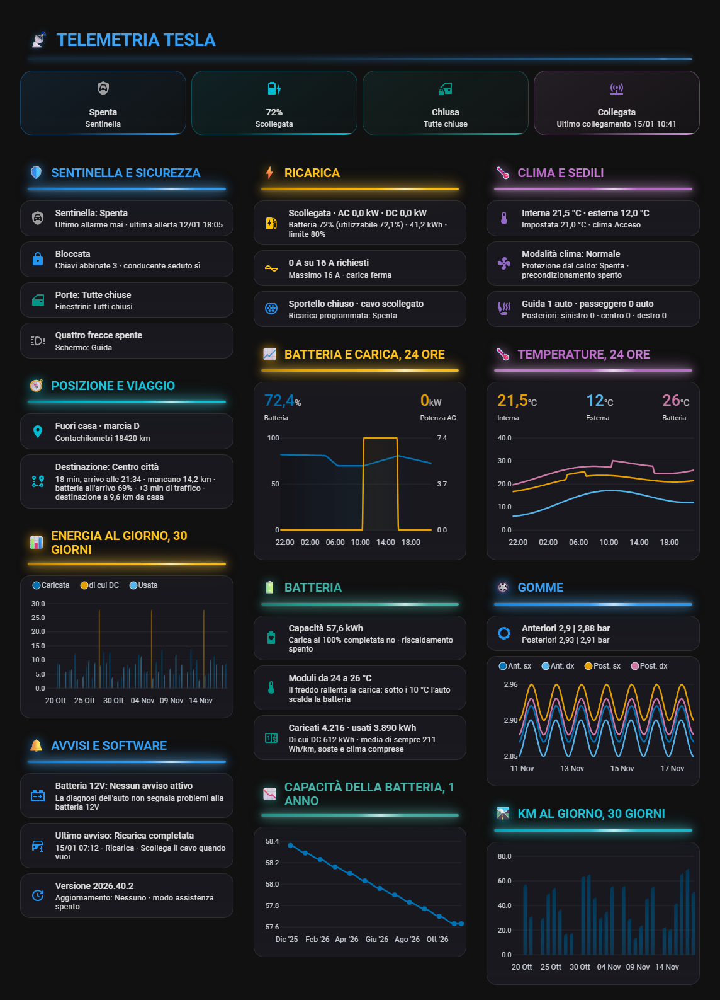

# Fleet Telemetry for Tesla vehicles in Home Assistant

Self-hosted [Tesla Fleet Telemetry](https://github.com/teslamotors/fleet-telemetry) for Home Assistant: Tesla's official
server in an add-on that also creates every entity by itself (MQTT discovery), computes derived values, measures the
battery capacity at each charge and sends notifications. A ready-made dashboard is included. No YAML package, no
AppDaemon app.

> **Beta (0.10.0-7).** This is a test release that comes before 1.0. It is provided as is, without warranty of any
> kind (MIT license): use it at your own risk. Please report problems as GitHub issues (see
> [Reporting a problem](#reporting-a-problem)). Tested on a Model 3 with Home Assistant OS 2026.11 on amd64. Entity
> names, dashboard texts, notifications and alert translations are in Italian for now.
>
> Not affiliated with, endorsed by or connected to Tesla, Inc. "Tesla" is a trademark of Tesla, Inc. and is used here
> only to describe compatibility.

*Screenshot made with demo data.*

## What you get

- **Add-on** with Tesla's official `fleet-telemetry` server (v0.10.0, image pinned by digest). The car connects to it
  with mutual TLS and the server publishes every record on MQTT. The server runs as an unprivileged user.
- **About 100 entities created automatically** on one device: Sentry Mode, doors, windows, lock, hazard lights, gear,
  driver seat, location, navigation (minutes, km and battery % at arrival, traffic delay, distance of the destination
  from home, "navigating home"), charging (state, power, current, phases, port, latch, schedule), battery (level, energy,
  power while driving, BMS capacity, module temperatures, lowest and highest cell voltage and their imbalance, heater), climate and seats, tyre pressures and warnings,
  lifetime counters, software version.
- **Derived values** computed by the add-on: doors and windows open, last Sentry alarm and alert with where it happened,
  last on-screen alert, 12 V battery diagnosis, last telemetry error, battery power, cell imbalance (with the battery
  at rest), Sentry events since parking, battery capacity
  measured at each charge (car firmware 2026.32 or later; with charging losses at home if you have a wallbox energy
  meter).
- **Notifications** through any Home Assistant notification service (mobile app, Telegram, persistent notification):
  Sentry alarm, Sentry alert away from home, new key paired, the car's on-screen alerts translated into Italian
  (1,456 Model 3 codes, each with its own priority), configuration expiry reminder, telemetry stopped. On-screen alerts
  and telemetry errors also go to the logbook.
- **Dashboard** with 24-hour, 7-day, 30-day and 1-year charts, ready to paste.
- **Tools** for the PC to create the certificates and to send the configuration to the car.

Why: the car pushes a field only when it changes, about one second later, without being woken up. Tesla prices
streaming at 150,000 signals per US dollar, against 500 vehicle data requests per dollar.

## Requirements

**1. A working Fleet API setup.** The usual way is the
[Tesla HTTP Proxy add-on by llamafilm](https://github.com/llamafilm/tesla-http-proxy-addon) with the
[Tesla custom integration](https://github.com/alandtse/tesla). It gives you:

- a developer application on [developer.tesla.com](https://developer.tesla.com) with billing enabled;
- a domain with a valid HTTPS certificate on port 443 that publishes the public key
  (`/.well-known/appspecific/com.tesla.3p.public-key.pem`), usually through the Nginx SSL proxy add-on;
- the virtual key paired with the car;
- a token for the Fleet API.

**2. For the telemetry:**

- a TCP port (default 4443) forwarded by the router **directly** to the Home Assistant host. **Do not put it behind a
  reverse proxy** (Nginx, Nginx Proxy Manager, Cloudflare): the car authenticates with its own client certificate, and
  a proxy that terminates TLS breaks it;
- a DNS name for your public IP (a DuckDNS name works);
- the server certificate does **not** need to be public: `crea_certificati.py` creates your own CA, and the CA is sent
  to the car inside the configuration;
- the Mosquitto add-on and the MQTT integration;
- Home Assistant 2025.10 or later (the entities use `default_entity_id`);
- recent car firmware: navigation fields need 2024.26 or later; the lifetime charge counters need 2026.32 or later
  (older firmware rejects those fields and the two sensors stay unknown);
- an amd64 Home Assistant host (other architectures are not built yet);
- for the dashboard: [mushroom](https://github.com/piitaya/lovelace-mushroom),
  [apexcharts-card](https://github.com/RomRider/apexcharts-card) and, optionally,
  [card-mod](https://github.com/thomasloven/lovelace-card-mod) from HACS.

**3. Signing.** Tesla only accepts a telemetry configuration signed with the application key. The llamafilm add-on
(2.3.0) bundles a 2024 version of Tesla's vehicle-command that does **not** sign it. `tools/firma_una_volta.py` checks
everything first, then takes the key from a backup of that add-on, starts Tesla's current proxy in a temporary add-on for
a few minutes, sends the configuration and deletes everything (it verifies the cleanup with the Supervisor). If your
proxy already signs, `configura_auto.py invia` is enough.

> **Backups:** for a few minutes the application key (which is also a virtual key of your car) is inside a temporary
> partial backup without password. If something copies every backup to the cloud (for example a backup sync add-on),
> pause it while the script runs. The script stops if an automatic Home Assistant backup is due within 30 minutes.

## Tools on the PC

Certificates and the car configuration are prepared from a PC (a later version will do this from the add-on).
Python 3.11 or later: `pip install cryptography websocket-client PyYAML`. Copy `tools/esempio_config.json` to
`tools/config.json` (excluded from git) and fill it in:

| Key | Meaning |
|---|---|
| `ha_url` | **LAN address** of the Home Assistant host (also used to reach the temporary signing proxy) |
| `ha_token_file` | file with a long-lived access token of an **administrator** (Supervisor API, backups, MQTT, helpers) |
| `telemetry_hostname`, `telemetry_port` | DNS name and port the car connects to (they go into the server certificate) |
| `topic_base` | MQTT topic base of the add-on (`telemetria_tesla`, fixed in the add-on) |
| `config_days` | validity of the car configuration, in days |
| `private_dir` | where the CA and server keys are kept (never in the repository) |
| `vin` or `vin_entity` | the VIN, or an entity with a `vin` attribute (for example the `_online` sensor of the Tesla custom integration) |
| `firmware_entity` | optional: an `update` entity with the installed car firmware (only for a warning) |
| `expiry_helper` | `input_datetime` where the expiry date is written (default `input_datetime.telemetria_tesla_scadenza`, created automatically; the add-on reads it for the reminder) |
| `token_source` | `tesla_custom` (read the integration token from `core.config_entries`, in memory only, never refreshed) or `file` |
| `core_config_entries`, `token_file` | path of `.storage/core.config_entries` (Samba share `config`) or of a file with a Fleet API access token (keep it outside the repository) |
| `proxy_url`, `proxy_cert` | signing proxy and its certificate (llamafilm: port 4430, `share/tesla/selfsigned.pem`) |
| `proxy_addon_slug`, `public_key_url` | slug of the llamafilm add-on and URL of your published public key |
| `ssh_host`, `ssh_key` | SSH add-on with key authentication; connect once by hand to accept the host key (the scripts use BatchMode) |
| `ssh_exe`, `gpg_exe`, `gpgconf_exe` | on Windows the programs of Git for Windows are used automatically; with Gpg4win set the two gpg paths |
| `share_addons`, `share_addon_configs`, `share_backup` | Samba shares of Home Assistant. Windows: `//host/share` after logging in to the shares once; Linux and macOS: mount them and use the mount paths |
| `temp_proxy_port` | local port of the temporary signing proxy (not forwarded by the router) |
| `charging_check_entities` | entities that must be `off` before signing (for example the charging switch) |

The scripts mask the VIN, the telemetry host name and any location in what they print. Check the output anyway before
pasting it into a public issue.

## Installation

1. **Certificates:** `python tools/crea_certificati.py crea`. Keys stay in `private_dir`.
2. **Add-on:** add this repository in the add-on store (Settings, Add-ons, Add-on store, three dots, Repositories:
   `https://github.com/MicheleMercuri/Tesla-Fleet-Telemetry-HA`) and install "Telemetria Tesla". Start it
   once: it stops because the certificates are missing, and the Supervisor creates its folder in `addon_configs`
   (`<hash>_telemetria_tesla`). Copy `server.crt` and `server.key` there, start it again and turn on the watchdog.
3. **Router:** forward TCP 4443 to the Home Assistant host, port 4443.
4. **Car:** `python tools/configura_auto.py anteprima` shows what will be sent and `configura_auto.py verifica` checks
   VIN, token and CA. Then `python tools/firma_una_volta.py` (llamafilm users) or `python tools/configura_auto.py invia`.
   The car picks it up the next time it wakes up: `configura_auto.py stato` must show `synced: True`, and
   `configura_auto.py errori` shows rejected fields. `python tools/osserva_mqtt.py 5` shows the MQTT messages of the next
   five minutes.
5. **Entities:** nothing to do. With the `discovery` option on (default) the device and its entities appear in Home
   Assistant with the first message from the car, with entity ids such as `sensor.tesla_tele_batteria`.
6. **Notifications (optional):** set `notifica` to a notification service, for example `notify.mobile_app_phone`,
   `telegram_bot.send_message` or `persistent_notification.create`, and restart the add-on. All options are described in
   the add-on's Documentation tab ([DOCS.md](telemetria_tesla/DOCS.md)).
7. **Dashboard:** create a new dashboard, open the raw configuration editor and paste
   [`homeassistant/plancia_telemetria.yaml`](homeassistant/plancia_telemetria.yaml) (made for the default prefix
   `tesla_tele_`). With another prefix, or without the map or card-mod, generate your own:
   `python homeassistant/vista_telemetria.py --prefisso <prefix> [--senza-mappa] [--senza-stile]`.

## Notifications

| Event | Sound | When |
|---|---|---|
| Sentry alarm (impact, glass, opening) | yes | always, with the count since parking and, away from home, a map link |
| Sentry alert (someone near the car) | no | only away from home, at most one every 15 minutes |
| New key paired | yes | when the number of paired phones and keys goes up |
| On-screen alert of the car | as the alert's priority | important alerts with sound, others muted or only in the logbook; muted while driving (D or R); charging alerts only if still active after 2 minutes; the same text at most every 6 hours |
| Configuration expiry | yes | at 9:00, 30, 7 and 1 day before and on the day (from the date written by `configura_auto.py`) |
| Telemetry stopped | yes / no | checked at 9:00: another integration's odometer ahead by more than 20 km (option `contachilometri_confronto`, with sound), or no data for more than N hours (option `ore_senza_dati`, muted) |

With Telegram every message is sent as plain text and "muted" means `disable_notification`; other services receive
muted notifications like the others. Sentry events count only changes seen live: a retained value that MQTT redelivers after
a restart or a reconnection is never an alarm. Keys, gear and charging state are compared with the last value saved by
the add-on, so a key paired while the add-on was stopped is notified when it starts again. If Home Assistant does not
answer or has not loaded the service yet (for example while it restarts), a notification is retried after 20, 60 and
120 seconds; if it is rejected, the add-on log shows the service, the HTTP code and Home Assistant's message when there
is one (often just "400: Bad Request").

To change the entity prefix, or before uninstalling, remove the entities first with the `togli` option (set
`conferma_togli` to the same prefix): the discovery configurations are kept by Mosquitto, so the old entities would stay.
With `discovery` off the add-on only runs the telemetry server (records on MQTT): no new entities, derived values,
notifications or logbook entries, and the entities created before stay until `togli` is used.

## MQTT topics

| Topic | Content |
|---|---|
| `telemetria_tesla/<VIN>/v/<Field>` | one retained message per field, from the server: numbers, booleans, enum strings with their prefix (`ShiftStateR`), objects for doors and location, `null` when the value does not exist (no route, car off) |
| `telemetria_tesla/<VIN>/alerts/<name>/current`, `/history` | on-screen alerts (`StartedAt`, `EndedAt`, `Audiences`) |
| `telemetria_tesla/<VIN>/errors/<name>` | errors reported by the car, for example `unsupported_field` |
| `telemetria_tesla/<VIN>/connectivity` | connection and disconnection (`Status`, `CreatedAt`) |
| `telemetria_tesla/<VIN>/derivati/<node>/<name>` | derived values from the add-on's scanner (`<node>` is the prefix without the final `_`) |
| `telemetria_tesla/scopritore/<node>/stato` | `online` or `offline`: availability of the derived values |
| `homeassistant/<component>/<node>/<name>/config` | MQTT discovery configurations |

## Reporting a problem

Open an issue with the **Bug report** template. Useful: Home Assistant and add-on versions, car model and firmware,
what happened and what you expected, the add-on log around the time (Settings, Add-ons, Telemetria Tesla, Log). The log
shows only the last 4 digits of the VIN; still check it for anything personal (host names, locations) before posting.
Never post tokens, keys or `tools/config.json`.

## Security

- The telemetry server accepts only clients with a certificate issued by Tesla to a car. It runs as the unprivileged
  user `nobody` inside the container, without the Supervisor token and without any Home Assistant token, and it does
  not write whole records to the log (they contain the VIN). Its log is filtered: normal disconnections are dropped and
  the VIN is shortened to its last 4 digits.
- The Home Assistant token (`homeassistant_api`) is given only to the scanner process, which needs it for
  notifications, the logbook, the home zone and the entities you name in the options.
- No secrets in this repository. Tokens are read from files at run time, `config.json` is ignored by git, private keys
  stay in `private_dir`, and `firma_una_volta.py` removes the application key from the server as soon as the temporary
  proxy has loaded it, deletes everything at the end and checks the cleanup.
- With `token_source: tesla_custom` the Fleet API token of the Tesla custom integration is read in memory and **never
  refreshed** by these scripts: Tesla refresh tokens are single use, and refreshing it from outside would break the
  integration.

## Known limits

- One car per add-on: another VIN on the same broker is ignored.
- The car does not send `LifetimeEnergyGainedRegen` (fleet-telemetry issues #398 and #436): the regenerated energy
  sensor stays unknown.
- `ScheduledDepartureTime` is rejected as `unsupported_field` by recent firmware, so it is not requested.
- The configuration expires (360 days by default): the add-on reminds you, then it must be sent again from the PC.
- Certificates and the car configuration are made from a PC for now.
- The add-on log shows "TLS handshake error ... EOF" every two minutes from the Supervisor watchdog, and the handshakes
  of internet scanners. Once the car connects correctly, the `nascondi_errori_handshake` option hides them (it also hides
  TLS errors of the car).
- Texts are in Italian; amd64 only.

## About the translated alerts

- The alert codes and the original English texts belong to Tesla, Inc. (`alert_dictionary.csv`, published by Tesla for
  Fleet API developers). This repository contains only the codes and an **unofficial Italian translation**; the MIT
  license covers the code and the translations, not Tesla's codes. Removed on request.
- The translation may be wrong or out of date: **what the car shows on its screen always prevails.** By design, airbag,
  brake and driving-assistance alerts go only to the Home Assistant logbook, without a notification, except the parking
  brake faults (not engaged, reduced function), which are notified with sound.

## Development

`python tests/prova_scopritore.py` runs the scanner tests without network (fake MQTT, fake Home Assistant, fake clock).

## Credits

- [teslamotors/fleet-telemetry](https://github.com/teslamotors/fleet-telemetry) and
  [teslamotors/vehicle-command](https://github.com/teslamotors/vehicle-command), Apache License 2.0.
- [llamafilm/tesla-http-proxy-addon](https://github.com/llamafilm/tesla-http-proxy-addon), Apache License 2.0: the
  Fleet API setup this project builds on.
- Alert texts: unofficial Italian translation of Tesla's `alert_dictionary.csv`.

## License

MIT, see [LICENSE](LICENSE).
